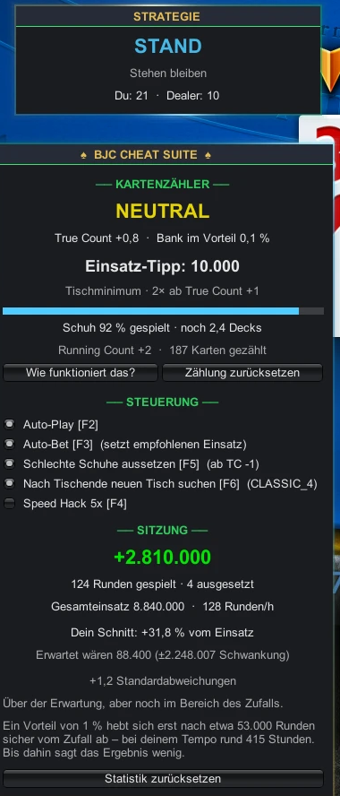

# ♠ Blackjack Championship Trainer

[](https://github.com/andreasssnbggg/Blackjack-Championship-Trainer/releases/latest)
[](https://github.com/andreasssnbggg/Blackjack-Championship-Trainer/releases)
[](LICENSE)
[](https://github.com/BepInEx/BepInEx/releases/tag/v5.4.23.2)
[](#technical-notes)

A BepInEx mod for **Blackjack Championship** (Steam) that adds a real-time **Hi-Lo card counter**, a **strategy advisor with count deviations**, **back-counting**, **session statistics** and optional **auto-play**, all in an in-game overlay (plugin name: *BJC Cheat Suite*).

> 🇬🇧 / 🇩🇪 The overlay supports **English** and **German**. It starts in your system language; toggle with **F7** or via the menu.

<p align="center"></p>

> [!WARNING]
> **Use at your own risk.** Blackjack Championship is an online, server-authoritative game. Automation tools very likely violate the game's Terms of Service and **can get your account banned**. This project is not affiliated with or endorsed by the game's developers. It is provided for educational purposes. You are responsible for how you use it.

---

## Quick Install

1. Install **[BepInEx 5.4.23.2 x86](https://github.com/BepInEx/BepInEx/releases/tag/v5.4.23.2)** (`BepInEx_win_x86_5.4.23.2.zip`) into your game folder and start the game once ([details](#install-bepinex)).
2. Download **`BJCCheat.dll`** from the **[latest release](https://github.com/andreasssnbggg/Blackjack-Championship-Trainer/releases/latest)**.
3. Copy it to `Blackjack Championship/BepInEx/plugins/`.
4. Start the game and press **F1**.

| | |
|---|---|
| **Tested with** | Blackjack Championship (Steam App ID 1178160), October 2026 build |
| **Mod version** | 1.2.3 |
| **Requires** | BepInEx 5.4.x **32-bit (x86)** |

---

## Features

| Feature | Description |
|---|---|
| **Card Counter** | Hi-Lo counting system with true count, running count, shoe progress, and player edge % |
| **Strategy Advisor** | Basic strategy for 4–8 decks, DAS, late surrender — **plus the Hi-Lo count deviations** (Illustrious 18 and Fab 4). Every departure from the chart is shown with its reason |
| **Dealer Rule Detection** | Watches finished dealer hands and works out whether the table is **H17 or S17**, then switches the chart over by itself |
| **Bet Advisor** | Bet spread from the true count (1× / 2× / 4× / 8× / 16× minimum, table max from +4) |
| **Back-Counting** | Optional: sits out bad shoes. The server takes your seat, counting continues from the side, and it takes a free seat again once the shoe turns |
| **Session Statistics** | Rounds, amount wagered, result — measured against the expectation **and the standard deviation**, so a lucky run can be told apart from an edge |
| **Insurance Advice** | Take/decline insurance based on true count (≥ +3 = take) |
| **Auto-Play / Auto-Bet** | Optional: plays the strategy and places the recommended bet automatically |
| **Auto-Rejoin** | Optional: when a table dies, looks for a new one of the same stage. Private tables are opened rather than matched into, which costs a ticket, so that half is a separate switch and off by default |
| **Private tables** | Counting, strategy, auto-play, auto-bet, back-counting and the statistics work there unchanged — they never ask what kind of table it is |
| **Speed Hack** | 5× game speed via `Time.timeScale` |
| **Quiet console** | Drops the Unity engine warnings that repeat every frame, so the log stays readable. Each filtered pattern is named once |
| **Bilingual UI** | Full German/English support, starts in your system language, toggle with F7 |

## Keybinds

| Key | Action |
|---|---|
| **F1** | Toggle menu window |
| **F2** | Toggle auto-play |
| **F3** | Toggle auto-bet |
| **F4** | Toggle speed hack (5×) |
| **F5** | Toggle sitting out bad shoes (back-counting) |
| **F6** | Toggle looking for a new table when this one ends |
| **F7** | Toggle language (DE ↔ EN) |

## The Overlay

The overlay shows two draggable windows:

- **Strategy window** (top): Shows the current optimal play (HIT / STAND / DOUBLE / SPLIT / SURRENDER), bet recommendation during betting phase, and insurance advice
- **Menu window** (bottom): Card counter with true count, running count, shoe progress bar, player edge %, bet tips, controls, session statistics, and an expandable "How does it work?" explanation

Both windows feature an animated glowing frame that shifts through emerald, teal, and gold.

---

## Installation (detailed)

### Install BepInEx

1. Download [BepInEx 5.4.23.2 x86](https://github.com/BepInEx/BepInEx/releases/tag/v5.4.23.2) (`BepInEx_win_x86_5.4.23.2.zip`)
2. Extract into your game folder:
   ```
   Blackjack Championship/
   ├── BepInEx/
   │   ├── core/
   │   ├── plugins/        ← BJCCheat.dll goes here
   │   └── ...
   ├── doorstop_config.ini
   ├── winhttp.dll
   └── Blackjack Championship.exe
   ```
3. Run the game once so BepInEx creates its config files, then close it.

### Build from Source

Only needed if you don't want to use the prebuilt DLL from the releases.

Requires the **.NET SDK 6.0+**.

1. Clone this repo
2. Open `BJCCheat.csproj` and update the `<GameDir>` path to match your Steam library:
   ```xml
   <GameDir>D:\SteamLibrary\steamapps\common\Blackjack Championship</GameDir>
   ```
3. Build:
   ```bash
   dotnet build -c Release
   ```
4. Copy `bin/Release/net472/BJCCheat.dll` to `<GameDir>/BepInEx/plugins/`

---

## How It Works

### Card Counting (Hi-Lo)

The mod hooks into the game's `BJTable.DecodeOnPlayUpdate` and `BJTable.DecodeOnAction` methods via Harmony to read every card dealt at the table. It tracks:

- **Running Count**: 2–6 = +1, 7–9 = 0, 10/J/Q/K/A = −1
- **True Count**: Running Count ÷ decks remaining (from server shoe data)
- **Player Edge**: ~0.5% per true count point above 0

The count resets automatically on shuffle and table change.

### Strategy Tables

Full basic strategy lookup tables for:
- Hard hands (5–21 vs dealer 2–A)
- Soft hands (S13–S21 vs dealer 2–A)
- Pair splits (AA–TT vs dealer 2–A)

With proper fallbacks: Double→Hit when can't double, Surrender→Hit when can't surrender, Double-or-Stand→Stand when can't double.

### Bet Spread

| True Count | Bet Size |
|---|---|
| < +1 | Table minimum |
| +1 | 2× minimum |
| +2 | 4× minimum |
| +2.5 | 8× minimum |
| +3 | 16× minimum |
| +4+ | Table maximum |

The true count is rounded to one decimal before any threshold is checked, so the number
the overlay shows is exactly the number that acts.

### Count Deviations

On top of basic strategy the advisor plays the Hi-Lo index plays — the Illustrious 18 and
the Fab 4 surrenders — for example *stand 16 vs 10 from TC 0*, *double 11 vs A from TC +1*,
*surrender 15 vs 9 from TC +2*. Splitting tens at a high count is implemented but off by
default: it is correct and extremely conspicuous.

Deviations are only played when the count can be trusted. After joining a table mid-shoe
most of the dealt cards were never seen and the running count is off by an unknown amount,
so the mod falls back to plain basic strategy and the table minimum until the next shuffle
(or sits the shoe out entirely, if back-counting is on).

### Back-Counting

This game stands you up after a single missed bet, so sitting out means losing the seat.
That is not a problem but the point: you stay in the room as a spectator, the count keeps
running, and once the shoe turns the mod takes any free seat again. Thresholds are
deliberately apart — out below TC −1, back in from TC 0 — so it cannot stand up and sit
down on every swing. After four skipped rounds in a row it pays one table minimum to hold
the seat, for tables that tolerate a missed bet.

Once the shoe has turned, the decision to go back in is held, not taken again every frame.
At a full table the wait for a seat lasts rounds, and the count moves while it lasts: a mod
that re-decides each time skips the seat that frees up at TC −0.4 and finds the table full
again by the time the count is back over the line. From the moment it wants in, every free
seat is taken immediately; only a shoe that turns genuinely bad again calls off the search.
The overlay says which of the two waits it is — for the shoe, or for a seat.

### Private Tables

Everything the mod reads from a table — the shoe, the hands, the seats, the bet limits —
comes from the same objects whatever kind of table it is, so counting, strategy, auto-play,
auto-bet, back-counting and the statistics need no special case.

Rejoining does. A public table is *matched into* from the lobby; a private one is *opened*,
and opening it costs a private-table ticket. So the two go down different paths, and the
private one is off until switched on, under the rejoin toggle, with the ticket count in the
label. It also checks the ticket before spending it and says what it is doing.

Two things behave differently there and the overlay cannot show it, so the log says it once
per table: the game offers no join buttons at a private table at all, so a seat given up
during back-counting can only be taken back by asking the server directly; and at a table
where nobody else is betting, sitting a round out can end the table — which then costs
another ticket. Back-counting stays switchable either way, but it is worth knowing before
leaving the bot alone at one.

### Session Statistics

A chip count cannot tell an edge from a lucky run, so the session panel puts the result
next to both the expectation (1 % of the amount wagered) and the standard deviation of the
rounds actually played. The verdict is the distance between them: under one standard
deviation is noise, over two is an outlier. It also states how many rounds a 1 % edge needs
before it rises clear of chance — about 53,000, which is the honest reason why no single
session proves anything.

The result is derived from the stack itself (start, minus detected buy-ins) and never from
a running sum of per-round deltas: summing deltas means every skipped round silently
deletes its money from the total and the figure drifts away from the real balance for good.

### Server-Authoritative

The game is server-authoritative: chips, cards, and results are validated server-side. This mod **cannot**:
- Give you infinite chips
- Change card values
- Manipulate game outcomes

It only provides **information** (counting, strategy) and optional **automation** of the plays a skilled player would make manually.

---

## Project Structure

```
src/
├── Plugin.cs           # BepInEx plugin entry point + IMGUI overlay
├── Lang.cs             # Bilingual string system (DE/EN)
├── Hooks.cs            # Harmony patches + auto-play/bet/insurance/back-counting logic
├── CardCounter.cs      # Hi-Lo counting engine, bet spread, wonging thresholds
├── StrategyAdvisor.cs  # Basic strategy tables, H17 overlay, count deviations
├── TableRules.cs       # Learns the dealer's soft-17 rule from observed hands
├── WongState.cs        # Back-counting state machine (sit-out intent vs. seat state)
├── SessionStats.cs     # Result, expectation, standard deviation
├── NoiseFilter.cs      # Which log lines are worthless (pure, tested)
├── LogNoise.cs         # Keeps Unity's repeating engine warnings out of the console
└── MonoShutdownFix.cs  # Fixes crash-on-exit caused by MonoMod

test/                   # Standalone test suite, runs without the game
```

| File | Purpose |
|---|---|
| **Plugin.cs** | BepInEx `[BepInPlugin]` entry point. Creates the overlay `GameObject`, applies Harmony patches, runs the `MonoShutdownFix`. Contains the full `CheatOverlay` MonoBehaviour with IMGUI rendering (two draggable windows with animated glow frames). |
| **Lang.cs** | Static localization class. `Dictionary<key, Dictionary<lang, text>>` with `Lang.T("key")` and `Lang.T("key", args)`. Supports `"de"` and `"en"`, toggled with `Lang.Toggle()`. |
| **Hooks.cs** | `ActiveTable` static class tracks the live `BJTable`, refreshes game state every update, and implements `PollAutoPlay()` / `PollAutoBet()` / `PollAutoInsurance()`. `TableUpdateHook` is the Harmony postfix on `DecodeOnPlayUpdate` and `DecodeOnAction`. |
| **CardCounter.cs** | Hi-Lo counting engine. Tracks running count, cards seen, shoe progress from server data, true count calculation, player edge estimate, and bet spread recommendations. Handles mid-shoe joins and deduplication of counted cards. |
| **StrategyAdvisor.cs** | Basic strategy lookup tables for hard, soft, and pair hands, an H17 overlay applied once the dealer rule is known, and the Hi-Lo index plays. Returns the action **and** the reason, so the overlay can show why it left the chart. Resolves Double/Surrender availability fallbacks. Insurance threshold at True Count +3. |
| **TableRules.cs** | Learns whether the dealer hits or stands on soft 17 by replaying each finished dealer hand card by card. A hand that passes through soft 17 and draws again settles H17 in one observation; the opposite case needs several sightings, because with every player busted the dealer never draws at all. |
| **WongState.cs** | Keeps the sit-out **intent** apart from the **state** of having no seat. The server takes the seat seconds after the skipped bet, and anything that forgets the intent in between never comes back. |
| **SessionStats.cs** | Rounds, amount wagered, result, expectation, standard deviation and the resulting verdict. Buy-ins are detected and kept out of the result. |
| **NoiseFilter.cs / LogNoise.cs** | Unity repeats some engine warnings once per object per frame, and BepInEx forwards all of them, so one misconfigured particle effect in the game buries everything else. A prefix on `Logger.InternalLogEvent` drops the known-worthless ones and names each pattern once, so nothing disappears silently. Only messages from the `Unity Log` source are candidates — a plugin is never silenced. The whole Unity feed could be switched off in `BepInEx.cfg` instead, but game-side exceptions arrive through that feed and are worth keeping. |
| **MonoShutdownFix.cs** | Repairs corrupted `friend_assembly_names` pointer in Mono assembly structs caused by MonoMod 22.01 (shipped with BepInEx 5.4.23). Prevents crash-on-exit in Unity 2022.3 x86. |

---

## Known Limitations

- **Hole card** is not visible: the server sends `"0u"` until the result phase, so the advisor only sees the dealer's up card
- **Side bets** are not supported by auto-play
- **Mid-shoe join**: if you sit down mid-shoe the count cannot be trusted. The overlay says so, bets stay at the minimum and the advisor plays plain basic strategy until the next shuffle
- **Session statistics** read the seat stack, so they only cover tables you actually sat at
- The game may update and break hooks. Check `Assembly-CSharp.dll` for API changes

## Tests

The strategy engine, the counter, the bet ladder, the rule detection, the back-counting
state machine and the statistics are covered by a standalone suite that needs neither the
game nor BepInEx:

```bash
cd test
dotnet run -c Release
```

It checks the charts cell by cell against the published S17/H17 references, every deviation
once exactly at its index and once just below it, and the bookkeeping invariant across a
randomised 400-round session. Blackjack maths cannot be eyeballed — a wrong number in a
table looks exactly like a right one.

## Troubleshooting

| Problem | Fix |
|---|---|
| No overlay, nothing happens | Make sure you installed the **x86** BepInEx build, not x64. Check `BepInEx/LogOutput.log` for errors. |
| `BepInEx` folder has no `plugins` / `config` | Start the game once after installing BepInEx. |
| Overlay appears but count stays 0 | The game probably updated and the hooks no longer match. Open an issue with your `LogOutput.log`. |
| Game crashes on exit | Should be fixed by `MonoShutdownFix`. If not, open an issue with your BepInEx and game version. |

---

## Technical Notes

- **BepInEx 5 (x86)** is required because the game is 32-bit Mono
- The overlay uses Unity **IMGUI** (`OnGUI`) since it's the simplest way to draw on top of everything without touching the game's UI system
- All window textures use `HideFlags.HideAndDontSave` to survive scene loads
- The `MonoShutdownFix` uses unsafe code to patch a single `uint` pointer at a known offset. It only acts on assemblies whose layout matches the expected Unity 2022.3 Mono struct

---

## License

MIT, see [LICENSE](LICENSE). Not affiliated with the developers or publishers of Blackjack Championship.
